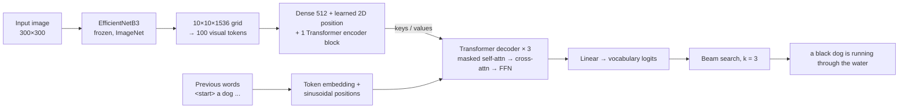

# Image Caption Generator

An end-to-end image captioning system that looks at a photo and writes an English sentence describing it. A frozen **EfficientNetB3** turns the image into a 10 × 10 grid of visual features, and a **Transformer decoder** with multi-head cross-attention generates the caption word by word. **Beam search** chooses the final sentence. The model was trained on **Flickr30k** and is served through a **FastAPI** backend with a built-in web UI.


<!-- Optional: record a short GIF of the UI (e.g. with ScreenToGif) and uncomment the next line -->
<!--  -->

---

## Highlights

- **Grid-feature encoder.** EfficientNetB3 (ImageNet weights, frozen) produces 100 spatial tokens of 1,536 dimensions each. A projection layer and one Transformer encoder block adapt them to the decoder.
- **Transformer decoder.** 3 pre-LayerNorm blocks with causal self-attention, multi-head cross-attention over the image tokens, and sinusoidal positional encoding.
- **Beam search inference.** Beam width 3 by default, with length normalization, `<unk>` blocking and no-repeat-trigram filtering.
- **Training that scales.** A config-driven `tf.data` pipeline with memory-mapped float16 features, so moving from Flickr8k to Flickr30k is a one-line change with no out-of-memory crashes.
- **Leakage-free evaluation.** Train, validation and test sets are split by image rather than by caption, and the vocabulary is built from training captions only.
- **Ready to deploy.** A FastAPI backend with Swagger docs, CORS, input validation and EXIF rotation handling for phone photos, plus a responsive web UI.

---

## Architecture



| Component | Setting |
|---|---|
| Image encoder | EfficientNetB3, 300 × 300 input, frozen |
| Visual tokens | 100 × 1536, projected to 512 |
| Decoder | 3 layers, 8 heads, d_model 512, FFN 2048, dropout 0.3 |
| Loss | Masked cross-entropy, label smoothing 0.1 (padding ignored) |
| Optimizer | AdamW (weight decay 1e-4), 5% linear warmup then cosine decay, gradient clipping 1.0 |
| Training | Batch size 64, early stopping on validation loss |
| Inference | Beam search, width 3, length penalty α = 0.7 |

---

## Results

Evaluated on 1,000 held-out **Flickr30k** test images (5 reference captions each) with corpus-level BLEU from NLTK.

| Decoding | BLEU-1 | BLEU-2 | BLEU-3 | BLEU-4 |
|---|---|---|---|---|
| Greedy | 0.xx | 0.xx | 0.xx | 0.xx |
| Beam search (k = 3) | **0.xx** | **0.xx** | **0.xx** | **0.xx** |

<!-- Fill these values from saved_models/flickr30k_test_results.json -->

Vocabulary: 7,389 words (minimum frequency 5). Maximum caption length: 28 tokens.

---

## Project structure

```
Image-Caption-Generator/
├── notebooks/
│   └── training_pipeline.ipynb   # Data prep, feature extraction, training, evaluation (Kaggle GPU)
├── src/
│   ├── model.py                  # EfficientNetB3 encoder, Transformer decoder, masked loss/metric
│   └── inference.py              # Vocabulary, preprocessing, beam search, CaptionGenerator
├── app/
│   ├── api.py                    # FastAPI backend (/caption, /health, web UI at /)
│   └── static/
│       └── index.html            # Web UI
├── saved_models/
│   ├── vocab.json                # Word ↔ index mapping
│   ├── model_config.json         # Architecture used to rebuild the model
│   └── caption_model.weights.h5  # Downloaded from GitHub Releases (not committed)
├── scripts/
│   └── download_model.py         # Fetches the trained weights
├── docs/                         # Screenshots for this README
├── requirements.txt
└── README.md
```

---

## Quick start

**1. Clone and create a virtual environment** (Python 3.13 was used; 3.10–3.13 should work with a matching TensorFlow version)

```bash
git clone https://github.com/shahipervez/Image-Caption-Generator.git
cd Image-Caption-Generator
python -m venv .venv
# Windows
.venv\Scripts\activate
# macOS / Linux
source .venv/bin/activate
pip install -r requirements.txt
```

**2. Download the trained weights** (about 97 MB)

```bash
python scripts/download_model.py
```

**3. Start the server**

```bash
uvicorn app.api:app --host 127.0.0.1 --port 8000
```

On first start, Keras downloads the EfficientNetB3 ImageNet weights (about 45 MB). Then open:

- **Web UI:** http://127.0.0.1:8000/
- **Swagger docs:** http://127.0.0.1:8000/docs

To test from a phone on the same Wi-Fi, start with `--host 0.0.0.0` and open `http://<your-PC-IP>:8000/`.

---

## API

| Method | Endpoint | Description |
|---|---|---|
| `GET` | `/` | Web UI |
| `GET` | `/health` | Model status, training dataset, vocabulary size |
| `POST` | `/caption` | Upload an image (`file`), returns the best caption and ranked alternatives |

`POST /caption` query parameters:

| Parameter | Default | Range | Meaning |
|---|---|---|---|
| `beam_width` | 3 | 1–10 | 1 means greedy decoding |
| `num_alternatives` | 3 | 1–10 | Number of ranked captions to return |

**curl**

```bash
curl -X POST "http://127.0.0.1:8000/caption?beam_width=3" -F "file=@dog.jpg"
```

**Python**

```python
import requests

with open("dog.jpg", "rb") as f:
    r = requests.post(
        "http://127.0.0.1:8000/caption",
        params={"beam_width": 3},
        files={"file": ("dog.jpg", f, "image/jpeg")},
    )
print(r.json())
```

**Example response**

```json
{
  "caption": "a black dog is running through the water",
  "score": -0.6123,
  "alternatives": [
    {"caption": "a black dog is running through the water", "score": -0.6123},
    {"caption": "a black dog runs through the water", "score": -0.6841}
  ],
  "beam_width": 3,
  "image_size": [500, 375],
  "inference_time_ms": 842.5,
  "filename": "dog.jpg"
}
```

`score` is the length-normalized log-probability of the sentence; higher is better.

Supported formats: JPEG, PNG, WebP, BMP, GIF (first frame), up to 10 MB. Environment variables `MODEL_DIR`, `MAX_UPLOAD_MB` and `ALLOWED_ORIGINS` override the defaults.

---

## Training

The full pipeline is in [`notebooks/training_pipeline.ipynb`](notebooks/training_pipeline.ipynb) and runs on a free Kaggle GPU (T4 or P100).

1. Add the Flickr8k or Flickr30k dataset to the notebook and turn on GPU and Internet.
2. In the configuration cell, set `DATASET = "flickr8k"` for quick prototyping or `"flickr30k"` for the final model.
3. Run all cells. The notebook:
   - cleans captions, splits by image and builds `vocab.json`
   - extracts EfficientNetB3 grid features once into a disk-backed float16 memmap
   - trains the Transformer decoder with masked loss, AdamW and early stopping
   - evaluates greedy and beam search with BLEU-1 to BLEU-4 on the test split
   - writes `src/model.py`, `src/inference.py` and everything in `saved_models/`

| Dataset | Images | Captions | Feature cache (float16) |
|---|---|---|---|
| Flickr8k | ~8,000 | ~40,000 | ~2.5 GB |
| Flickr30k | ~31,800 | ~159,000 | ~9.8 GB |

---

## Design notes

- **Why freeze the CNN and cache features?** The encoder output never changes during training, so each image is encoded once instead of once per caption per epoch. Training becomes several times faster, and memory-mapped features keep RAM usage flat as the dataset grows.
- **Why no padding mask in self-attention?** Padding always comes after `<end>`, and the causal mask already stops real tokens from attending to later positions. Padded positions are excluded from the loss and the accuracy metric instead.
- **Why label smoothing?** Each image has five valid captions, so a confident one-hot target is unrealistic. Smoothing reduced overfitting on the small Flickr8k prototype.
- **Why share weights across three Keras models?** The training model, encoder model and decoder model use the same layers. At inference the image is encoded once and only the decoder runs at each beam step.

---

## Limitations and next steps

- Captions follow the style and vocabulary of Flickr, which is mostly people, animals and everyday scenes. Unusual objects often map to the closest common word.
- BLEU rewards word overlap rather than meaning; CIDEr and METEOR would give a fuller picture.
- Possible improvements: fine-tune the top EfficientNet blocks, use a larger backbone or ViT features, train on MS-COCO, and export to TensorFlow Lite for an on-device mobile app.

---

## Acknowledgements

- Datasets: Flickr8k (Hodosh et al., 2013) and Flickr30k (Young et al., 2014)
- Vaswani et al., *Attention Is All You Need*, 2017
- Xu et al., *Show, Attend and Tell: Neural Image Caption Generation with Visual Attention*, 2015
- Tan and Le, *EfficientNet: Rethinking Model Scaling for Convolutional Neural Networks*, 2019

---

## Author

**Shahi Pervez Pulok**
[GitHub](https://github.com/shahipervez) · [LinkedIn](https://www.linkedin.com/in/shahi-pervez-pulok-27541a1b2) · [Kaggle](https://www.kaggle.com/pulokcse)

## License

Released under the [MIT License](LICENSE).
